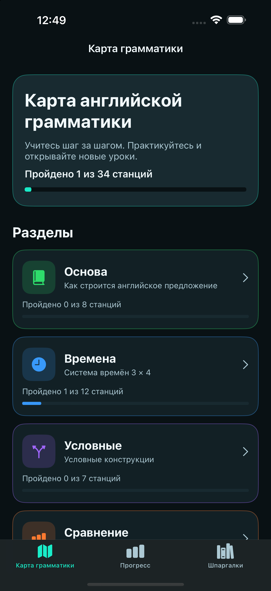
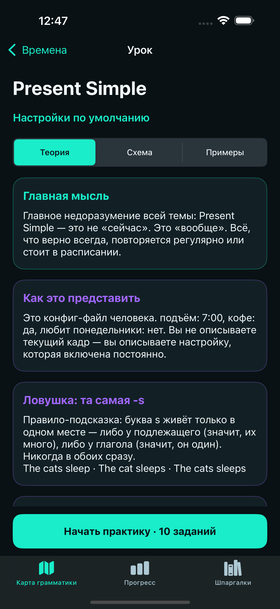
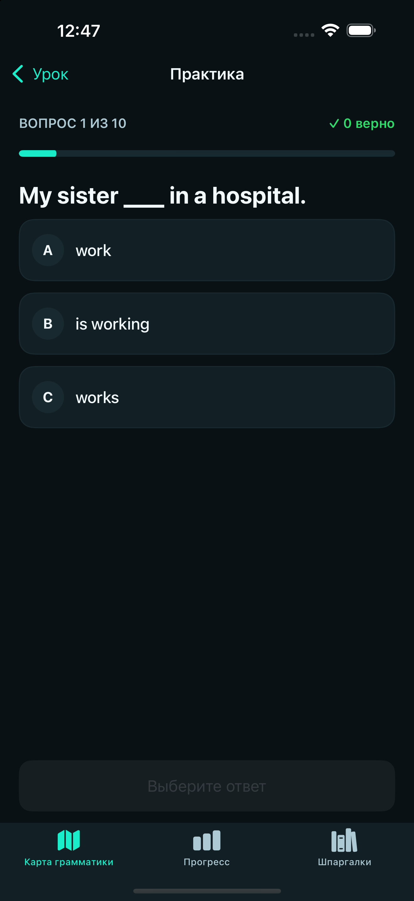
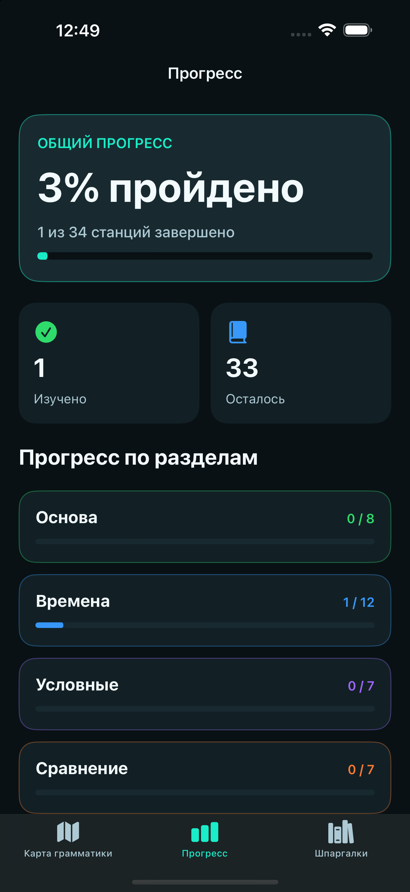
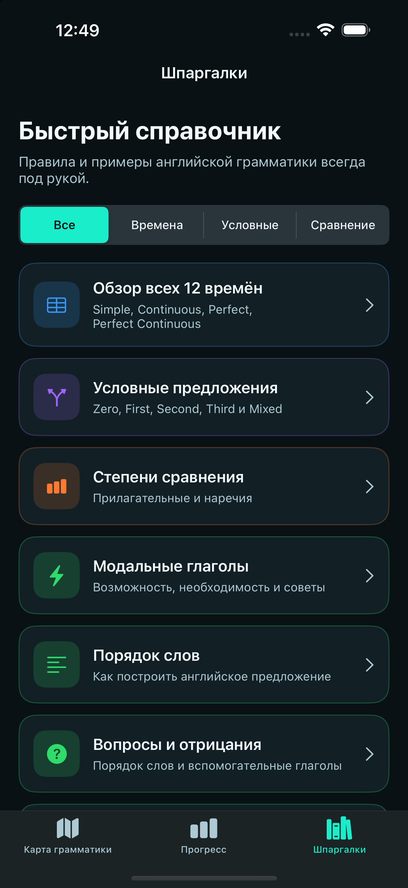
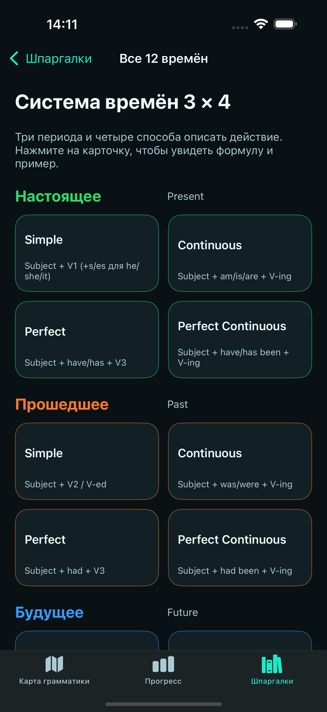
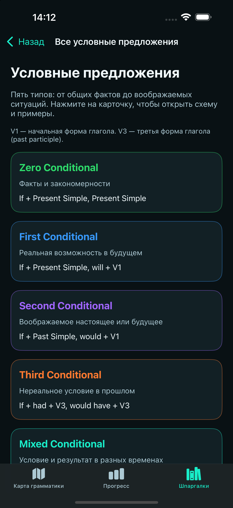
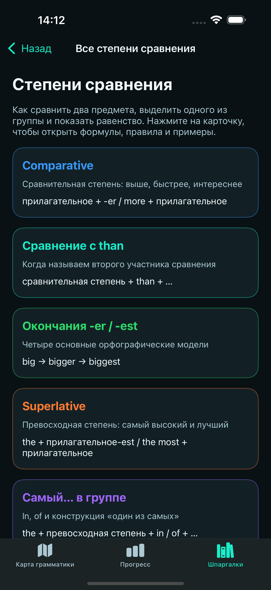

# EnglishGrammar

**Нативное приложение для iPhone: английская грамматика шаг за шагом.**

Офлайн-уроки с объяснениями на русском языке, английскими примерами и сохранением прогресса.

[Возможности](#features) · [Скриншоты](#app-screenshots) · [Архитектура](#architecture) · [Тестирование](#validation) · [Запуск](#run-locally)

## Возможности

- **[34 урока и 340 вопросов](EnglishGrammar/Resources/grammar_content.json)** в четырёх разделах: основы, времена, условные предложения и степени сравнения.
- **Теория и примеры:** правила, схемы предложений и переводы.
- **Практика с обратной связью:** объяснения ответов, подсчёт баллов и перемешивание вариантов один раз на попытку.
- **Последовательное обучение:** результат от 70% правильных ответов в одной попытке открывает следующий урок раздела.
- **Локальный прогресс:** завершённые уроки, лучшие результаты и общий прогресс сохраняются между запусками.
- **Три интерактивных справочника:** формулы, примеры и переходы к соответствующим урокам.

## Скриншоты

Реальные снимки iOS Simulator: iPhone 16 Pro Max, iOS 18.6. Нажмите на изображение для просмотра в полном разрешении; длинные страницы продолжаются прокруткой.

<table>
  <tr>
    <td align="center">
      <strong>Карта грамматики</strong> 
      
    </td>
    <td align="center">
      <strong>Урок</strong> 
      
    </td>
  </tr>
  <tr>
    <td align="center">
      <strong>Практика</strong> 
      
    </td>
    <td align="center">
      <strong>Прогресс</strong> 
      
    </td>
  </tr>
</table>

## Технологии и архитектура

| Технология | Применение |
| --- | --- |
| Swift | Основной язык приложения. |
| UIKit | Программная вёрстка, Auto Layout и Dynamic Type, без Storyboard. |
| MVVM + Coordinator | `LearningMapViewModel`, `ProgressViewModel` и `QuizViewModel` готовят состояние карты, прогресса и практики; `AppCoordinator` связывает экраны и зависимости. |
| Core Data | Хранение завершённых уроков и лучших результатов. |
| Swift Concurrency | `async/await` для загрузки JSON; интерфейс и доступ к прогрессу изолированы на `@MainActor`. |

Подробности устройства проекта — в [ARCHITECTURE.md](docs/ARCHITECTURE.md).

## Интерактивные справочники

**12 времён**, **Zero–Mixed Conditional** и **степени сравнения**. Карточки открывают формулы, примеры с переводом и уроки. Ограничения доступа к практике сохраняются.

Показать экран «Шпаргалки» и три справочника

<table>
  <tr>
    <td align="center">
      <strong>Шпаргалки</strong> 
      
    </td>
    <td align="center">
      <strong>12 времён</strong> 
      
    </td>
  </tr>
  <tr>
    <td align="center">
      <strong>Условные предложения</strong> 
      
    </td>
    <td align="center">
      <strong>Степени сравнения</strong> 
      
    </td>
  </tr>
</table>

## Тестирование

Подтверждено прохождение **84 XCTest** локально и в [CI для PR #2](https://github.com/Alexander6Shevtsov/EnglishGrammar/actions/runs/40114082884): ViewModel, единое правило прохождения 70%, перемешивание ответов, разблокировка, Core Data, контент и навигация.

[GitHub Actions](.github/workflows/ios.yml) выполняет сборку Debug для симулятора и XCTest при push и pull request в `main`. Команды сборки доступны в workflow; история проверок и оставшиеся задачи — в [ROADMAP.md](docs/ROADMAP.md).

## Запуск проекта

1. Склонируйте репозиторий на Mac с Xcode.
2. Откройте `EnglishGrammar.xcodeproj` в Xcode на Mac и выберите схему **EnglishGrammar**.
3. Выберите симулятор iPhone с **iOS 16.0+** и нажмите **⌘R**.
4. Для запуска тестов нажмите **⌘U**.

## Статус разработки

**In Development.** Основной учебный сценарий реализован. Предстоят редактура материалов, расширенная проверка доступности и тестирование на физических устройствах перед выпуском.

Документация: [архитектура](docs/ARCHITECTURE.md) · [план развития](docs/ROADMAP.md) · [учебные материалы и их проверка](docs/CONTENT.md).

Концепты дизайна, а не скриншоты приложения: [обложка](docs/concepts/cover-concept.png) и [экраны](docs/concepts/screens-concept.png).

**Автор:** [Alexander Shevtsov](https://github.com/Alexander6Shevtsov) — проект для портфолио iOS-разработчика.
