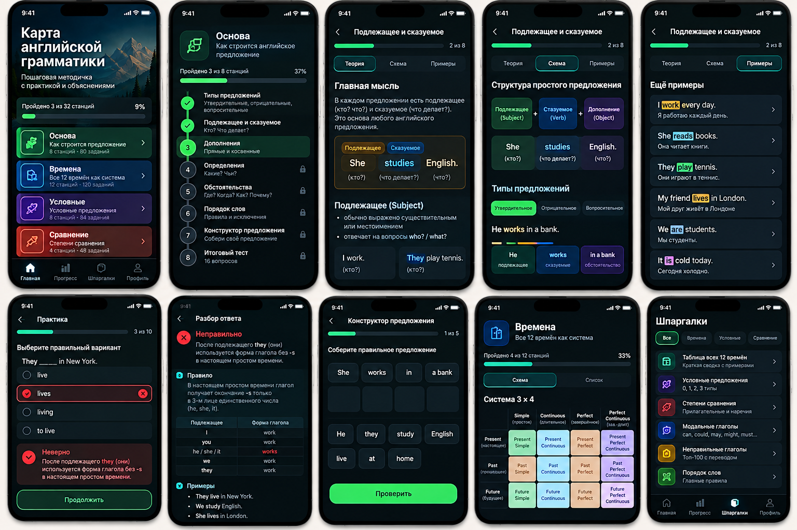

# EnglishGrammar

**A native iPhone app for learning English grammar, one lesson at a time.**


An offline learning experience built with **Swift, programmatic UIKit, MVVM + Coordinator, Core Data, and Swift Concurrency**. The app combines a guided learning map, focused practice, and interactive grammar references. Lessons and explanations are in Russian, with English examples and translations.

[Features](#features) · [Architecture](#architecture) · [Run locally](#run-locally) · [Validation](#validation) · [Roadmap](docs/ROADMAP.md)

## Features

- **Guided learning map:** four sections, 34 lessons, and 340 multiple-choice questions, all bundled with the app.
- **Lesson pages:** grammar explanations, sentence patterns, and examples with translations.
- **Practice with feedback:** answer-specific explanations, correct-answer highlighting, and a running score. A new attempt shuffles the answer options once; their order stays fixed throughout that attempt.
- **Consistent progression:** the first lesson in each section is available immediately. Completing a lesson with at least **70% correct in one attempt** opens the next lesson in that section.
- **Persistent progress:** Core Data stores lesson completion and the highest number of correct answers. A completed lesson remains completed after a weaker retake; sections progress independently.
- **Progress dashboard:** overall completion, completed and remaining lesson counts, and progress by section.
- **Three interactive references:** tappable cards open detailed rules, formulas, English examples, translations, and links to the corresponding lessons. Reference links preserve practice restrictions.
- **Native presentation:** a dark interface, shared design tokens, Auto Layout, Dynamic Type text, and accessibility labels for key controls.

### Curriculum

| Section | Lessons | Questions |
| --- | ---: | ---: |
| Foundations and sentence structure | 8 | 80 |
| English tenses | 12 | 120 |
| Conditional sentences | 7 | 70 |
| Comparisons | 7 | 70 |
| **Total** | **34** | **340** |

Each lesson contains 10 questions. The curriculum is decoded from [grammar_content.json](EnglishGrammar/Resources/grammar_content.json); question text and explanations stay unchanged when answer options are shuffled.

### Interactive references

| Reference | Content |
| --- | --- |
| **All 12 tenses** | Present, past, and future grouped by Simple, Continuous, Perfect, and Perfect Continuous, with formulas, usage notes, and examples. |
| **Conditional sentences** | Zero, First, Second, Third, and Mixed Conditional, with formulas, examples, and lesson links. |
| **Comparisons** | Comparative and superlative forms, `-er` / `-est`, `more` / `most`, spelling rules, irregular forms, `than`, and `(not) as…as`. |

## Architecture

The project follows **MVVM + Coordinator**, with repository protocols separating content and persistence from the UI:

| Component | Responsibility |
| --- | --- |
| `AppCoordinator` | Composes dependencies, owns the three navigation stacks, checks practice access, and routes lesson, quiz, and return-to-map actions. |
| UIKit view controllers | Build screens in code, render content, handle lifecycle updates, and forward navigation events through closures. |
| `QuizViewModel` | Owns one attempt: shuffled question snapshots, answer evaluation, feedback, score, and question advancement. Other screens currently keep presentation logic in their view controllers. |
| `GrammarContentRepository` | Loads immutable `Codable` / `Sendable` curriculum values from bundled JSON through `async/await`. |
| `ProgressRepository` | Exposes progress operations; `CoreDataProgressRepository` persists results using a programmatically defined model. |
| `LessonUnlockRule` | Evaluates sequential unlocking within a section independently of UIKit. |

UI coordination, quiz state, and progress access are isolated to `@MainActor`. JSON file reading and decoding run in a detached task. Core Data managed objects stay within the main-actor repository; screens receive values rather than managed objects.

The app uses no Storyboards, third-party libraries, backend, or account system. See [Architecture](docs/ARCHITECTURE.md) for navigation, concurrency boundaries, persistence semantics, and current limitations.

## Project structure

```text
EnglishGrammar/
├── Application/
│   ├── AppDelegate.swift
│   ├── SceneDelegate.swift
│   └── AppCoordinator.swift
├── Core/
│   ├── DesignSystem/GrammarPalette.swift
│   ├── Models/GrammarModels.swift
│   └── Services/
│       ├── BundledGrammarRepository.swift
│       ├── ProgressRepository.swift
│       └── LessonUnlockRule.swift
├── Features/
│   ├── LearningMap/LearningMapViewController.swift
│   ├── Lesson/LessonViewController.swift
│   ├── Quiz/
│   │   ├── QuizViewController.swift
│   │   └── QuizViewModel.swift
│   ├── Progress/ProgressViewController.swift
│   └── Reference/
│       ├── ReferenceViewController.swift
│       ├── GrammarTensesMatrixViewController.swift
│       ├── GrammarConditionalsViewController.swift
│       ├── GrammarComparisonsViewController.swift
│       ├── GrammarReferenceOverviewViewController.swift
│       └── GrammarReferenceDetailViewController.swift
├── Resources/
│   ├── grammar_content.json
│   └── Assets.xcassets/
└── Info.plist
EnglishGrammarTests/                 # 10 XCTest classes, 59 tests
EnglishGrammar.xcodeproj/            # Shared EnglishGrammar scheme
.github/workflows/ios.yml            # Simulator build and XCTest
docs/                               # Architecture, roadmap, content notes, concepts
```

## Run locally

**Target:** iPhone, portrait orientation, **iOS 16.0 or later**. Use a Mac with Xcode and an installed iPhone simulator runtime. CI is configured for Xcode 16.4; the recorded local validation used Xcode 27.1. No package installation is required.

```sh
git clone https://github.com/Alexander6Shevtsov/EnglishGrammar.git
cd EnglishGrammar
open EnglishGrammar.xcodeproj
```

1. Select the shared **EnglishGrammar** scheme.
2. Choose an available iPhone simulator running iOS 16.0 or later.
3. Press **⌘R** to build and run, or **⌘U** to run all XCTest.
4. To run on a physical iPhone, select your signing team in Xcode and choose the device.

### Command-line checks

Run from the repository root:

```sh
xcodebuild -project EnglishGrammar.xcodeproj -scheme EnglishGrammar \
  -configuration Debug -destination 'generic/platform=iOS Simulator' \
  CODE_SIGNING_ALLOWED=NO build

xcodebuild -project EnglishGrammar.xcodeproj -scheme EnglishGrammar \
  -configuration Release -destination 'generic/platform=iOS Simulator' \
  CODE_SIGNING_ALLOWED=NO build
```

List available simulators with `xcrun simctl list devices available`, then replace `<SIMULATOR_UDID>` below with an available iPhone's identifier:

```sh
xcodebuild -project EnglishGrammar.xcodeproj -scheme EnglishGrammar \
  -configuration Debug \
  -destination 'platform=iOS Simulator,id=<SIMULATOR_UDID>' \
  CODE_SIGNING_ALLOWED=NO test
```

## Validation

Recorded local checks for the implementation merged in [Pull Request #1](https://github.com/Alexander6Shevtsov/EnglishGrammar/pull/1), completed on **October 24, 2026**:

| Check | Result |
| --- | --- |
| Debug iOS Simulator build | Passed |
| Release iOS Simulator build | Passed |
| XCTest on iPhone 16 Pro / iOS 18.6 | **59 passed, 0 failed, 0 skipped** |
| Manual simulator checks | Navigation, practice access, all three references, reference Dynamic Type layouts, answer shuffling, and progress after relaunch checked across development validation runs. |

The test suite covers quiz scoring and feedback, deterministic shuffling and retakes, lesson unlocking, section independence, isolated persistence, legacy progress records, JSON totals and answer validity, reference-to-lesson identifiers, and navigation regressions. UIKit presentation tests exercise controls directly; a separate XCUITest target has not been added.

[GitHub Actions](.github/workflows/ios.yml) runs a **Debug simulator build and XCTest** for pushes and pull requests to `main`. The [PR #1 head validation run](https://github.com/Alexander6Shevtsov/EnglishGrammar/actions/runs/40081657779) succeeded. Release builds were verified locally; the workflow currently has no Release build step.

Remaining validation work includes physical-device QA, a broader accessibility audit, and release preparation. Existing local warnings include AppIntents metadata extraction being skipped, XCTest deployment-version linker warnings, and SQLite diagnostics while two persistence tests clean up temporary stores. See the [roadmap](docs/ROADMAP.md).

## Design studies

The images below are **design concepts, not screenshots of the running app**. They document the visual direction; they do not establish feature availability or an exact match to the current UIKit interface.

<details>
<summary>View concept artwork</summary>




</details>

## Development status

**In Development.** The core learning loop, persistent progression, interactive references, and automated regression coverage are implemented. Upcoming work focuses on content review, accessibility and device testing, real application screenshots, and release readiness. Optional future interactions are listed separately in the [roadmap](docs/ROADMAP.md).

[Architecture](docs/ARCHITECTURE.md) · [Roadmap](docs/ROADMAP.md) · [Content provenance and QA](docs/CONTENT.md)

**Author:** [Alexander Shevtsov](https://github.com/Alexander6Shevtsov)
An iOS development portfolio project focused on native UI, maintainable navigation, local persistence, concurrency, and testable application behavior.
